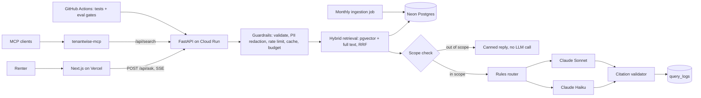

# TenantWise

Ask questions about renting in Ontario and get plain language answers where every sentence cites the Residential Tenancies Act or an official Ontario guide.

**Live:** https://tenantwise.jeffanojohn.com · **Stats:** https://tenantwise.jeffanojohn.com/stats · **MCP:** `uvx tenantwise-mcp`

> General legal information, not legal advice. For your situation, contact the Landlord and Tenant Board, Legal Aid Ontario, or a community legal clinic.

## Architecture



## Results

Fill this table in from `backend/evals/reports/` and `/api/stats`. Never estimate.

| Metric | Value |
|---|---|
| Retrieval hit rate at 6, hybrid vs vector only | [X]% vs [Y]% |
| Faithfulness (LLM judge, [Z]% agreement with human labels) | [X]% |
| Citation validity | [X]% |
| Out of scope refusal accuracy | [X]% |
| Routed vs Sonnet only: quality, cost per query | [X] pts, [Y]% cheaper |
| p50 and p95 latency | [X] s, [Y] s |
| Users and questions (last 30 days) | [X], [Y] |

## Repository layout

| Path | Purpose |
|---|---|
| `backend/app` | FastAPI service: retrieval, guardrails, routing, generation, logging |
| `backend/ingestion` | Fetch, chunk, hash and embed sources incrementally |
| `backend/evals` | Golden set, retrieval and LLM judge evals, CI thresholds |
| `backend/sql` | Postgres schema (pgvector, full text search, cache, logs) |
| `mcp_server` | Published MCP server, a thin client over the search API |
| `frontend` | Next.js app with streaming answers and citation links |
| `.github/workflows` | CI with eval gates, Cloud Run deploy, monthly reingest |
| `docs` | Build guide and design decisions |

## Run locally

See [docs/SETUP_GUIDE.md](docs/SETUP_GUIDE.md) for the full guide. Short version:

```bash
cd backend && python3.12 -m venv .venv && source .venv/bin/activate
pip install -r requirements-dev.txt && cp .env.example .env   # fill in values
python -m ingestion.ingest && uvicorn app.main:app --reload --port 8080
cd ../frontend && cp .env.example .env.local && npm install && npm run dev
```

## Known limitations

General information only. Retrieval covers the curated corpus, not case law or LTB decisions. Cold starts add a few seconds after idle periods. English only for now.
